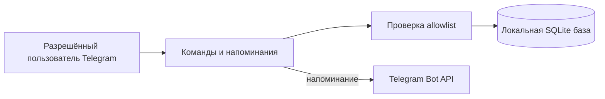

# Personal AI Chief of Staff


Личный Telegram inbox для задач, заметок и напоминаний. Данные остаются в локальной SQLite базе, а доступ к боту ограничен списком Telegram user ID.

[](https://github.com/jezannn16/personal-ai-chief-of-staff/actions/workflows/ci.yml)

**Навигация:** [Возможности](#возможности) · [Быстрый старт](#быстрый-старт) · [Команды](#команды) · [Проверки](#проверки) · [Безопасность и ограничения](#безопасность-и-ограничения)

## Возможности

- Добавление задач и заметок, просмотр списка на сегодня, поиск и отметка задачи выполненной.
- Напоминания сохраняются между перезапусками; SQLite атомарно резервирует доставку, чтобы параллельные проходы не отправили её дважды.
- Настройки timezone и quiet hours хранятся отдельно для каждого пользователя.
- `/briefing` показывает просроченные и сегодняшние задачи, ближайшие дедлайны и свежие заметки.
- Бот автоматически отправляет такую же сводку один раз за локальную дату пользователя в час `BRIEFING_HOUR` (по умолчанию 08:00).
- Все чтение и изменение данных ограничены Telegram user ID.



## Быстрый старт

Нужны Python 3.11+ и [uv](https://docs.astral.sh/uv/).

```sh
uv sync --extra dev
cp .env.example .env
```

Создайте бота через BotFather. В `.env` локально задайте `TELEGRAM_BOT_TOKEN` и `ALLOWED_USER_IDS` — ваш числовой Telegram user ID. Токен не публикуйте и не отправляйте в чат.

```sh
uv run chief-of-staff
```

База по умолчанию `chief_of_staff.sqlite3`. Путь и значения по умолчанию для timezone/quiet hours и `BRIEFING_HOUR` находятся в `.env.example`.

## Команды

| Действие | Пример |
| --- | --- |
| Добавить задачу | `/add Подготовить отчёт` |
| Создать напоминание | `/add 2030-05-01 15:30 | Позвонить` |
| Сохранить заметку | `/note Идея для проекта #работа` |
| Посмотреть открытые задачи | `/inbox` или `/today` |
| Найти задачи и заметки | `/search проект` |
| Завершить задачу | `/done 12` |
| Установить timezone | `/timezone Europe/Moscow` |
| Тихие часы | `/quiet 23 8` |
| Посмотреть активные напоминания | `/reminders` |
| Отменить напоминание | `/cancelreminder 12` |
| Сводка | `/briefing` |

Время дедлайна вводится в timezone пользователя и сохраняется в UTC.

## Проверки

```sh
uv run pytest
uv run ruff check src tests
```

Тесты используют временные SQLite базы и не обращаются к Telegram. GitHub Actions выполняет те же проверки на Python 3.11 и 3.12.

## Безопасность и ограничения

Бот запускается только с непустыми `TELEGRAM_BOT_TOKEN` и `ALLOWED_USER_IDS`. Храните `.env` локально: он исключён из Git. Для личного использования указывайте только собственный numeric user ID. SQLite база и существующие sidecar-файлы создаются с правами владельца (`0600`).

Доставка напоминаний работает по принципу at-most-once: после неопределённой сетевой ошибки автоматического повтора нет, чтобы не создавать дубликаты. Если процесс завершился во время отправки, claim старше 10 минут закрывается как `unknown` и записывается в журнал без повторной отправки. Активные напоминания можно просмотреть и отменить командами `/reminders` и `/cancelreminder ID`; просмотр полной истории попыток пока доступен только в SQLite. Calendar OAuth и LLM-интеграции не реализованы.
